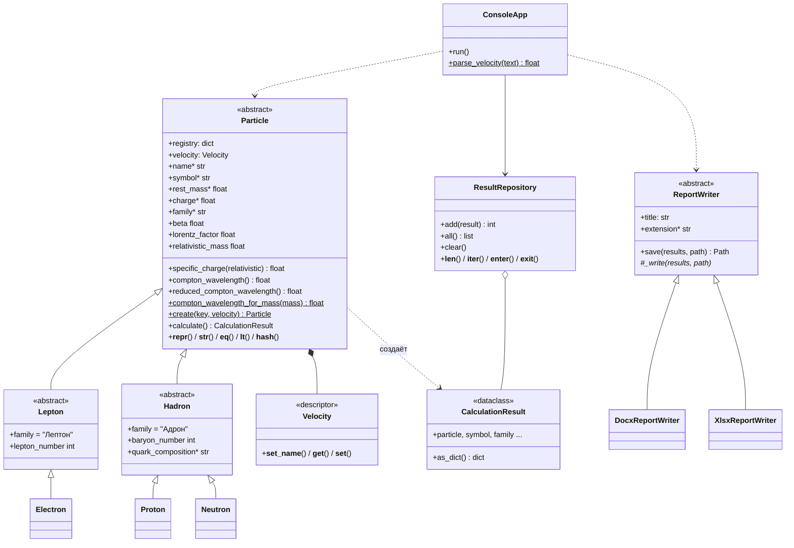

# Particles Calc — элементарные частицы

Лабораторная работа №2 «Модули и пакеты Python. ООП». **Вариант 13.**
Выполнены все уровни сложности: **Rare + Medium + Well-done**.

## Описание

Консольное приложение считает характеристики трёх элементарных частиц: **электрона, протона и нейтрона**.

| Величина | Формула | Единицы |
|---|---|---|
| Удельный заряд | q / m₀ | Кл/кг |
| Комптоновская длина волны | λc = h / (m₀·c) | м |
| Приведённая комптоновская длина волны | ƛc = ħ / (m₀·c) = λc / 2π | м |
| Лоренц-фактор (если задана скорость v) | γ = 1 / √(1 − v²/c²) | — |
| Релятивистский удельный заряд | q / (γ·m₀) | Кл/кг |

Константы взяты из CODATA 2018: h = 6.62607015·10⁻³⁴ Дж·с, c = 299 792 458 м/с,
e = 1.602176634·10⁻¹⁹ Кл, mₑ = 9.1093837015·10⁻³¹ кг, mₚ = 1.67262192369·10⁻²⁷ кг,
mₙ = 1.67492749804·10⁻²⁷ кг.

Что умеет программа:
- ввод параметров (частица, скорость) и вывод результатов расчёта;
- сравнение всех трёх частиц;
- сохранение каждого расчёта в БД SQLite (`data/results.db`);
- сохранение отчёта в **Word (.docx)** и **Excel (.xlsx)** (папка `reports/`);
- запуск в Docker.

## Инструкции по запуску

### Вариант 1. Обычный запуск (Python 3.10+)

```bash
python -m venv venv
```

```bash
source venv/bin/activate
```

(в Windows: `venv\Scripts\activate`)

```bash
pip install -r requirements.txt
```

```bash
python main.py
```

Необязательные параметры: `python main.py --db data/results.db --reports reports`.

### Вариант 2. Docker

```bash
docker build -t particles-lab .
```

```bash
docker run -it --rm -v "$(pwd)/data:/app/data" -v "$(pwd)/reports:/app/reports" particles-lab
```

`-it` нужен, потому что программа интерактивная (ждёт ввода). Флаги `-v` подключают папки
`data/` и `reports/` с компьютера, чтобы БД и отчёты остались после выхода из контейнера.
В Windows PowerShell вместо `$(pwd)` пишите `${PWD}`.

### Тесты

```bash
pytest -v
```

Тесты в Docker:

```bash
docker run --rm particles-lab pytest -v
```

## Краткая справка

Пункты меню:

| Пункт | Действие |
|---|---|
| 1 | Расчёт для одной частицы: выбрать 1/2/3 (электрон/протон/нейтрон), ввести скорость |
| 2 | Расчёт сразу для всех частиц при одной скорости (таблица сравнения) |
| 3 | История расчётов из БД |
| 4 | Отчёт по всей истории в `.docx` |
| 5 | Отчёт по всей истории в `.xlsx` |
| 6 | Очистить историю |
| 0 | Выход |

Скорость вводится в м/с (`1e6`, `250000`) или в долях скорости света (`0.5c`).
Пустой ввод — частица покоится (v = 0). Скорость должна быть `0 ≤ v < c`, иначе выводится ошибка.

Ожидаемые значения (v = 0):

| Частица | q/m, Кл/кг | λc, м |
|---|---|---|
| Электрон | −1.758820·10¹¹ | 2.426310·10⁻¹² |
| Протон | 9.578833·10⁷ | 1.321410·10⁻¹⁵ |
| Нейтрон | 0 | 1.319591·10⁻¹⁵ |

## Структура проекта

```
Lab_2/
├── main.py              # основная программа: консольное меню (класс ConsoleApp)
├── particles/           # пакет из 3 модулей
│   ├── __init__.py      # делает папку пакетом, экспортирует классы
│   ├── models.py        # классы частиц (ABC, наследование), константы, расчёты
│   ├── database.py      # сохранение результатов в SQLite (ResultRepository)
│   └── reports.py       # отчёты .docx / .xlsx (ReportWriter и наследники)
├── tests/               # тесты pytest
├── requirements.txt     # зависимости
├── Dockerfile           # сборка Docker-образа
├── pytest.ini           # настройки pytest
└── ШПАРГАЛКА.md         # подробный разбор для защиты
```

## UML-диаграмма классов


